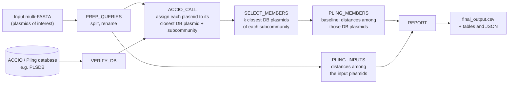

# clust-assess
Assessing pling clusters of potentially related plasmids

# Objective

Given a set of plasmids that are suspected on being involved in an outbreak, are these plasmids more closely related to each other (lower intra-cluster variability) than others in public databases based on the pling subcommunity?

This is a way to identify subgroups from within pling subcommunities, and is a threshold-free way of assessing plasmid clusters (aside from pling thresholds).

## Inputs

A multi-fasta file containing the plasmids of interest, and a database (pling PLSDB)

## Outputs

A results file listing the within-subcommunity variability of each input plasmids relative to the within-subcommunity variability of closest databases plasmids. 

If the within-subcommunity variability of the input plasmids is much lower than within-cluster variability, this indicates the plasmids may be closely related and part of an outbreak. If the within-subcommunity variability of the input plasmids is much higher than within-cluster variability, this indicates that the plasmids are not closely related. If the subcommunities for all input plasmids are different, then the plasmids are not related. 

## Workflow diagram

# Tasks 
- [X] get dataset from galaxy onto CLIMB and make pling database - Nathan
- [X] PLSDB pling onto CLIMB (`shared-team/pling_plsdb/`)
- [X] run ACCIO on Galaxy test dataset
- [X] split PLSDB file prior to ACCIO
    - [X] like pling sourmash pre-filtering, separate it by community or subset PLSDB regionally (Denmark)
- [X] testing pling add with `-asyn` to not re-compute clusters and run fast, with PLSDB pling or using PLSDB pling mash distance to pull closest subcommunity
- [X] make GitHub page 
- [X] writing workflow - Robin
- [X] pull metadata for PLSDB from Denmark and filter down database
- [X] example output data structure - Gijs
- [X] extracting distance distributions for subcommunity/containment files and scripting
- [X] pling database for Denmark plasmid subset
- [X] positive test dataset from Denmark PLSDB
- [X] script for distance distributions for subcommunity/containment and adding to nextflow
- [ ] environment (conda, singularity, etc) for ACCIO
- [ ] download pipeline & results from CLIMB
- [X] script to combine input plasmids with matched subcommunity and calculate pairwise distance (ACCIO find results and pull out plasmids from db)
- [ ] add PLSDB (or other database file) as dependency
- [ ] test dataset from Denmark IncN2
- [ ] test statistics for pairwise distances - Celia - Gijs
- [ ] interactive HTML output with plots for visualization - Effiong
- [ ] slide crafting - Celia/Greb (https://docs.google.com/presentation/d/10MKGGLl1-xBAk1CIupZDHvlDTj6iIlOrWHoXWIbNbCY/edit?usp=sharing)
- [ ] update name to revelio
