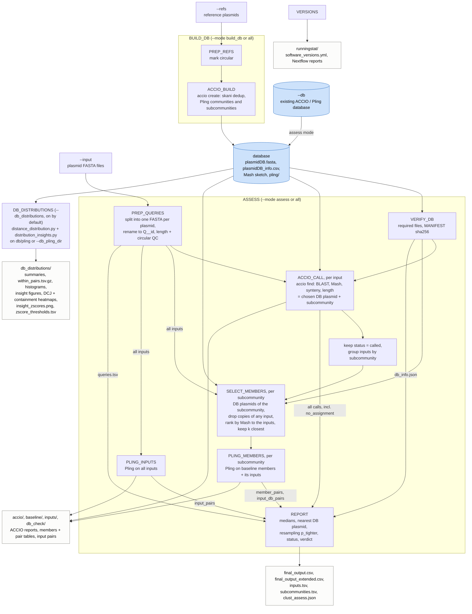

# clust-assess: pipeline flow

How the Nextflow workflow (`main.nf`) runs, from input FASTA files to the published results. See [README_workflow.md](README_workflow.md) for parameters, outputs and how to read the verdict.

- `--mode assess` uses an existing database (`--db`); `--mode build_db` only builds one from `--refs`; `--mode all` builds it and then assesses the inputs against it.
- `DB_DISTRIBUTIONS` and `VERSIONS` run in every mode.
- Inputs that ACCIO cannot place still reach `REPORT`, as `no_assignment`.

| Step | Runs | What it does |
|---|---|---|
| `PREP_REFS`, `ACCIO_BUILD` | once, `build_db` / `all` | Build the ACCIO database: de-duplicate with skani, cluster with Pling |
| `VERIFY_DB` | once | Check the database files and their checksums |
| `PREP_QUERIES` | once | One FASTA per input plasmid, renamed `Q__<id>` |
| `ACCIO_CALL` | per input | Closest database plasmid and its Pling subcommunity |
| `SELECT_MEMBERS` | per subcommunity | The k database plasmids closest to the inputs (Mash), without copies of the inputs |
| `PLING_MEMBERS` | per subcommunity | Pling distances among those plasmids, and from each input to them |
| `PLING_INPUTS` | once | Pling distances among all inputs |
| `REPORT` | once | Inputs against the baseline: medians, resampling test, status and verdict |
| `DB_DISTRIBUTIONS` | once, every mode | Distance distributions and figures of the database's own Pling run |
| `VERSIONS` | once, every mode | Tool versions |
