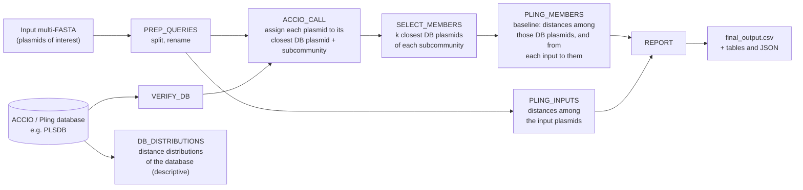
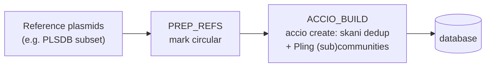

# clust-assess

**Assessing Pling clusters of potentially related plasmids.**

Given a set of plasmids suspected of being part of an outbreak, clust-assess asks whether they are more closely related to each other than the closest public plasmids of the same [Pling](https://github.com/iqbal-lab-org/pling) subcommunity. It finds subgroups within Pling subcommunities. Apart from Pling's own thresholds, no relatedness cut-off is needed: the inputs are compared with the variability that the public database (PLSDB) already shows for that subcommunity.

How to read the result:
- **Much lower variability than the database:** the plasmids may be closely related and part of an outbreak.
- **Similar or higher variability than the database:** the plasmids are not unusually closely related.
- **Inputs in different subcommunities:** the plasmids are not related.


---

## How it works



1. **Assign:** ACCIO matches each input plasmid to the most similar plasmid in the reference database. It scores BLAST identity and coverage, Mash containment, synteny and length. This places the input in that plasmid's Pling **subcommunity**.
2. **Baseline:** for every subcommunity that receives an input, the k database plasmids closest to the inputs (Mash, default k = 20) are compared with each other using Pling (containment and DCJ-Indel distances). Database plasmids that *are* inputs (same sequence or same name) are left out, so the inputs are never compared with themselves. The same Pling run also gives each input's distances to those database plasmids, and so its nearest database plasmid.
3. **Inputs:** Pling compares all input plasmids with each other, using the same thresholds.
4. **Compare:** the inputs' pairwise distances are reported next to the baseline. A resampling test then asks how often random sets of database plasmids, the same size as the input set, are at least as tight as the inputs.
5. **Describe the database** (`DB_DISTRIBUTIONS`, on by default): within-subcommunity and within-community distance distributions of the database's own Pling run, with figures. This shows how tight the database's subcommunities are, and which inputs could have no baseline at all. See [`db_distributions/`](#db_distributions).

The database is built once, with `accio create`, from reference plasmids such as PLSDB. Building it can be part of the run (`--mode build_db` or `--mode all`):



---

## Quick start

```bash
git clone https://github.com/SPREAD-Hackathon/clust-assess.git && cd clust-assess
bash tools/install.sh          # creates the two conda envs (see Requirements) and prints the --*_env arguments
ENVS="--clust_assess_env <core env> --mobsuite_env <mobsuite env> --amrfinder_env <mobsuite env>"

# 1. assess suspected outbreak plasmids against an existing database
nextflow run main.nf $ENVS --input suspects.fasta --db /path/to/plsdb_accio_db

# 2. or build a database from reference plasmids and assess in one go
nextflow run main.nf $ENVS --mode all --refs references.fasta --input suspects.fasta --db_name my_db

# checks
nextflow run main.nf $ENVS -profile standard,stub -stub-run    # wiring only, no tools needed (seconds)
nextflow run main.nf $ENVS -profile standard,test              # real run on the test data (~5 min)
```

Results are written to `results/` (change this with `--results_dir`). On CLIMB, see [Running on CLIMB](#running-on-climb).

---

## Requirements

- [Nextflow](https://www.nextflow.io/) ≥ 24.04. Developed with 26.04.1.
- Conda or mamba (miniforge), for `tools/install.sh`.
- Tools in the core env (`tools/env-clust-assess.yml`):

  | tool | version |
  |---|---|
  | ACCIO | 0.1.0, commit `6f6386a` (editable install of `tools/accio`, see below) |
  | Pling | 3.0.3 (bioconda build; `pling --version` prints 3.0.2) |
  | plasnet | 0.7.0 |
  | skani | 0.4.0 |
  | MUMmer | 4.0.1 |
  | Mash | 2.3 |
  | BLAST+ | 2.17 |
  | Python | 3.11 |

  The pipeline stops if `nucmer` is not MUMmer 4. `tools/install.sh` installs ACCIO from a clone at the pinned commit in editable mode. A regular `pip install git+https://github.com/mpgriffith/accio` is not enough: ACCIO's `setup.py` packages only `data/*.csv` and `data/*.txt`, so `data/repetitive.dna.fas` is missing and `accio create` fails.
- **MOB-suite** (3.1.9) and **AMRFinderPlus** (4.2.7) with their databases, in a **second env** (`tools/env-mobsuite.yml`). ACCIO calls both. They cannot share the core env: MOB-suite 3.1.x needs `numpy<1.23.5` and Pling 3 needs `numpy>=1.26`. A single env silently falls back to Pling 2.0.2 (which has no `pling cluster` command) or to MOB-suite 3.0.0. Each process puts the core env first on `PATH`, then the MOB-suite and AMRFinder envs (`--clust_assess_env`, `--mobsuite_env`, `--amrfinder_env`).
- Memory: plan for ≥ 8 GB. The test run peaked at 8 GB with up to 5 CPUs in use.

---

## Inputs

| parameter | description |
|---|---|
| `--input` | One or more FASTA files with the plasmids of interest, one **complete** plasmid per record. The record name becomes the plasmid name in the output. Plasmids are treated as circular unless you set `--queries_circular false`. |
| `--db` | Path to a database folder made by `accio create`, e.g. the PLSDB Pling database. It needs `plasmidDB.fasta`, `plasmidDB_info.csv` (column `pling_type` = Pling subcommunity) and `plasmidDB.fasta.msh`. `representative_plasmids.csv` and `plasmids_before_clustering.fasta` are used when present (see [Baseline](#baseline-members)). |
| `--refs` | Only with `--mode build_db` or `--mode all`: reference plasmid FASTA(s) for the database. |

---

## Output

### `results/final_output.csv`

This is the main result: `;`-separated, one row per **pair of input plasmids**.

```
Plasmid A;Plasmid B;DCJ;community_DCJ;containment;community_containment
outbreak_CP067528.1;outbreak_CP067834.1;0;0;0;0
outbreak_CP067528.1;outbreak_NZ_CP136409.1;0;0;0;0
other_NZ_CP039944.1;outbreak_CP067528.1;NA;NA;1;NA
```

| column | meaning |
|---|---|
| `Plasmid A`, `Plasmid B` | The two input plasmids |
| `DCJ` | Pling DCJ-Indel distance between them (the number of structural events). `NA` = Pling computed none because the pair failed the containment threshold, i.e. the plasmids are too different. |
| `community_DCJ` | **Baseline:** median DCJ-Indel distance among the k closest database plasmids of the subcommunity both inputs belong to |
| `containment` | Pling containment **distance** between the two inputs. 0 = the smaller plasmid is fully contained in the larger; 1 = nothing shared. |
| `community_containment` | **Baseline:** median containment distance among those database plasmids |

`community_*` is `NA` when the two inputs were assigned to **different subcommunities**, so they are not one related cluster.

### Other files in `results/`

| file | content |
|---|---|
| `subcommunities.tsv` | One row per subcommunity hit by the inputs: number of inputs and of database plasmids (`n_members_excluded` = database copies of the inputs left out), `median_dcj_inputs` versus `community_DCJ`, `median_dcj_inputs_to_db`, resampling p-values, and **status** |
| `inputs.tsv` | One row per input plasmid: ACCIO call (`called` / `no_assignment` with reason), ACCIO's closest database plasmid, ACCIO and Mash scores, subcommunity, and from Pling: `nearest_db_plasmid` with `nearest_db_dcj` / `nearest_db_containment` (smallest DCJ, then smallest containment, among the baseline plasmids), `median_dcj_to_db`, `n_db_compared`, and `in_db_as` (database plasmids that are this input) |
| `final_output_extended.csv` | `final_output.csv`, plus the subcommunity of each plasmid, whether the DCJ was censored, the subcommunity status, and `p_tighter` |
| `clust_assess.json` | All of the above plus an overall verdict, for the interactive HTML report |
| `accio/`, `baseline/`, `inputs/`, `db_check/` | Intermediate results: ACCIO calls, baseline plasmids (`<subcommunity>.members.tsv`, with `copy_of_input` for left-out copies) and their distances (`<subcommunity>.member_pairs.tsv`), input-to-database distances (`<subcommunity>.input_db_pairs.tsv`), input pairs, database check |
| `db_distributions/` | Distance distributions of the database itself (see below); turn off with `--db_distributions false` |
| `runningstat/` | `software_versions.yml`, and Nextflow `execution.html`, `timeline.html`, `trace.txt` and `dag.html` |

### `db_distributions/`

Describes the database's own Pling run: `<db>/pling` by default, or `--db_pling_dir`. It runs once per run, in every mode. It is descriptive only: nothing else reads it, and if it fails the run still finishes (Nextflow prints a NOTE).

| file | content |
|---|---|
| `subcommunity_summary.tsv`, `community_summary.tsv` | One row per group with ≥ 2 members: size, pairs, DCJ and containment quantiles, pairs not computed (`*_censored`), share within the Pling threshold |
| `within_pairs.tsv.gz` | Every within-group pair with its DCJ and containment distance |
| `subcommunity_distribution.png`, `community_distribution.png` | Histogram and box plots of the largest groups |
| `insight_group_sizes.png` | Plasmids alone in their group: an input that lands there has no baseline |
| `insight_same_vs_other.png` | Pairs in the same subcommunity vs pairs that only share a community (cumulative) |
| `insight_dcj_vs_containment.png` | DCJ against containment for every within-community pair (needs containment distances) |
| `insight_heatmaps.png` | Distance matrices of the largest communities (DCJ above the diagonal, containment below), subcommunities boxed |
| `run_info.json`, `distributions.log` | Files used, thresholds, counts, log |

A missing pair is a pair Pling never computed. For DCJ, that means the pair failed the containment filter. These pairs are counted as "too different" (censored), not dropped.

`--db_containment` only sets the threshold that is drawn and counted; Pling is not re-run. Set it to the threshold of the database's Pling run: ACCIO uses 0.3, the Zenodo PLSDB run used 0.5.

The same files can be made outside the workflow, for any Pling output folder:

```bash
python bin/distance_distribution.py --pling_dir <pling dir> --outdir <out> --containment_threshold 0.3 --plots
python bin/distribution_insights.py --dist_dir <out>
```

### Status and verdict

For each subcommunity with ≥ 2 input plasmids, `p_tighter` is the share of random sets of baseline plasmids, of the same size as the input set, whose median DCJ is ≤ the inputs' median DCJ. When there are at most `--n_resample` possible sets, all of them are enumerated (exact test).

| status | meaning |
|---|---|
| `tighter_than_db` | `p_tighter` ≤ `--alpha` (0.05): the inputs are unusually closely related for this subcommunity. This is consistent with an outbreak or recent shared origin. |
| `similar` | The inputs vary about as much as the closest database plasmids |
| `looser_than_db` | The inputs are more variable than the database plasmids |
| `single_input` | Only one input plasmid fell in this subcommunity |
| `no_baseline` | Too few database plasmids to form a baseline |

The **overall verdict** in `clust_assess.json` has three possible values:
- the single subcommunity's status, when all assigned inputs share one subcommunity;
- `inputs_split`, when they fall into several subcommunities (not one related cluster);
- `no_assignment`, when ACCIO could place none of them.

---

## Parameters

| parameter | default | description |
|---|---|---|
| `--mode` | `assess` | `assess` (needs `--input`, `--db`) \| `build_db` (needs `--refs`) \| `all` (needs `--refs`, `--input`) |
| `--containment` | `0.5` | Pling containment-distance threshold for the input and baseline comparisons |
| `--dcj` | `4` | Pling DCJ-Indel threshold |
| `--k_closest` | `20` | Database plasmids per subcommunity used as the baseline, closest by Mash to the inputs (`0` = the whole subcommunity) |
| `--baseline_members` | `all` | `all` = include plasmids that ACCIO de-duplicated; `representatives` = only the representative plasmids |
| `--exclude_input_copies` | `true` | Leave database plasmids that are inputs (identical sequence, or same name) out of the baseline |
| `--input_db_distances` | `true` | Run each subcommunity's inputs through Pling together with its baseline plasmids, for the input-to-database distances (`false` = baseline plasmids only, faster) |
| `--n_resample` / `--alpha` / `--seed` | `1000` / `0.05` / `2026` | Resampling test |
| `--db_outdir` / `--db_name` | `db/` / `clust_assess_db` | Where `build_db` writes the database |
| `--db_distributions` | `true` | Write [`db_distributions/`](#db_distributions) |
| `--db_pling_dir` | `<db>/pling` | Pling output folder to describe there |
| `--db_containment` | `0.3` | Containment threshold of that Pling run; only drawn and counted |
| `--results_dir` | `results/` | Output folder |
| `--max_cpus` | `4` | Upper limit of CPUs per process (CLIMB allowance) |
| `--accio_create_args`, `--accio_find_args`, `--pling_args` | | Extra arguments passed to `accio create`, `accio find` and `pling cluster align` (default `--visualisation none`) |

## Profiles

| profile | use |
|---|---|
| `standard` (default) | Local executor. Tools come from the conda envs set by `--clust_assess_env`, `--mobsuite_env` and `--amrfinder_env`. |
| `docker` | Runs every process in the image built from `tools/Dockerfile` (`docker build -t clust-assess:0.1.0 -f tools/Dockerfile tools/`) |
| `climb` | CLIMB-BIG-DATA (`conf/climb.config`): each task runs as a Kubernetes pod, tools come from the two conda envs on `/shared/team`. See below. |
| `test` | Builds a 33-plasmid test database and assesses 6 test plasmids (combine with `standard` or `climb`) |
| `stub` | Placeholder data for `-stub-run`, to check the pipeline wiring without tools |

### Running on CLIMB

CLIMB notebooks have no Docker. Nextflow there runs each task as a Kubernetes pod. CLIMB keeps the pod settings (the `/shared/team` volume, node selector) in `/etc/nextflow.config`, which Nextflow does not load by itself; `-profile climb` includes it. The notebook itself has only 2 CPUs, so the `standard` profile (local executor) cannot start the 4-CPU processes.

- Put both conda envs, the clone and the inputs under `/shared/team`. Pods cannot see `/home/jovyan`, so launch from the `/shared/team/...` path, not from `~/shared-team/...`.
- The pod image defaults to the notebook's own image (`$JUPYTER_IMAGE_SPEC`, falling back to `ubuntu:24.04`); change it with `--climb_image`.

```bash
cd /shared/team/<dir>/clust-assess
CORE_PREFIX=/shared/team/<dir>/env-core MOB_PREFIX=/shared/team/<dir>/env-mobsuite bash tools/install.sh
nextflow run main.nf -profile climb --input suspects.fasta --db /shared/team/<dir>/<accio_db> \
    --clust_assess_env /shared/team/<dir>/env-core \
    --mobsuite_env /shared/team/<dir>/env-mobsuite --amrfinder_env /shared/team/<dir>/env-mobsuite
```

`tools/climb_test.sh` runs the unit tests, the stub run and the `test` profile on CLIMB and writes a report.

---

## Runtime

Measured on the `test` profile: 33 reference plasmids and 6 input plasmids, on a 16-core / 11 GB WSL machine. Total wall time ~5 min (19 CPU-min), peak 8 GB.

| step | time |
|---|---|
| `ACCIO_BUILD` (33 references) | 2 min |
| `ACCIO_CALL` (per input plasmid) | ~10 s (30 s when nothing matches) |
| `PLING_INPUTS` (6 plasmids) | 28 s |
| `PLING_MEMBERS` (≤ 10 database plasmids + that subcommunity's inputs) | 35 s – 1.2 min |
| everything else | seconds |

Building a database from a large reference set takes far longer. The ACCIO paper reports ~1.5 h for 368 plasmids, so for PLSDB, build per community or region (e.g. Denmark) rather than all at once.

---

## Things to know when interpreting results

- <a id="baseline-members"></a>**The baseline includes de-duplicated plasmids.** `accio create` collapses near-identical plasmids (skani, ≥ 99.95% ANI, ≥ 98% alignment fraction) into one representative. If only representatives formed the baseline, the database would look more variable than it is, and inputs would too easily come out `tighter_than_db`.
  - Example from the test data: 15 IncX3 references collapsed into 2 representatives.
  - Three identical IncX3 inputs therefore looked "tighter" against representatives only, but are `similar` against all database plasmids (the default). IncX3 plasmids are near-clonal in public data.
- **Two containment thresholds.** `accio create` uses Pling containment 0.3 to *define* subcommunities. The distances reported here use `--containment` (0.5), the same for inputs and baseline.
- **Not every plasmid gets an ACCIO call.** ACCIO filters the database by the input's PlasmidFinder replicons, requires Mash ≥ 0.995 and score ≥ 0.80, and excludes plasmids under 10 kb. Uncalled plasmids are listed as `no_assignment` with a reason in `inputs.tsv`; they are never dropped. They still appear in `final_output.csv` with their distances to the other inputs.
- **The baseline describes the inputs' neighbourhood.** It uses the k database plasmids *closest* to the inputs, not the whole subcommunity. Set `--k_closest 0` for the whole subcommunity.
- **Inputs that are already in the database.** A database plasmid with exactly the same sequence as an input, or the same name, is the input itself: it is listed in `members.tsv` (`copy_of_input`) and `inputs.tsv` (`in_db_as`) but left out of the baseline. Near-identical plasmids stay in: they are real relatives. A copy that is rotated or reverse-complemented is not recognised. If the database was built from the inputs themselves, little or nothing may be left for the baseline (`no_baseline`): the database should hold the reference plasmids to compare with.
- **Public data is biased** towards some countries, years and resistance genes. A `similar` result means "as related as what has already been sequenced and published", which says nothing about plasmids that were never sequenced.

---

## Repository layout

```
main.nf                 entry point (--mode build_db | assess | all)
nextflow.config         parameters, resources, profiles
conf/climb.config       CLIMB profile
workflows/
  build_db.nf           PREP_REFS, ACCIO_BUILD
  assess.nf             VERIFY_DB, ACCIO_CALL, SELECT_MEMBERS, PLING_MEMBERS, PLING_INPUTS, REPORT
  utils.nf              PREP_QUERIES, VERSIONS
bin/clust_assess.py     command-line helper called by the processes
src/clust_assess/       Python logic: ACCIO and Pling parsers, baseline selection, statistics, report
tests/                  pytest unit tests (fixtures from real ACCIO and Pling output), stub data,
                        make_test_data.py (rebuilds test_data/ from public plasmids)
tools/                  install.sh, conda env files (core + MOB-suite), Dockerfile, climb_test.sh
test_data/              33 reference + 6 input public plasmids for -profile test
```

---

